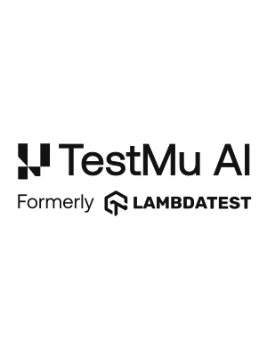

<a>
  <picture>
    <source
      media="(prefers-color-scheme: light)"
      srcset="./docs/images/testmu_black.svg">
    <source
      media="(prefers-color-scheme: dark)"
      srcset="./docs/images/testmu_white.svg">
    
  </picture>
</a>

## Overview

TestMu AI Selenium Automation Grid enables you to perform end-to-end automation tests on a secure, reliable, and scalable Selenium infrastructure. You can perform automated cross browser testing with Selenium scripts on 3000+ browsers and operating systems environments, giving you higher test coverage and at significantly less built times. TestMu AI will help you evaluate how well your web application renders when accessed through a variety of different browsers.

## Features
Features of the TestMu AI Automation Jenkins Plugin:

- Integrate your Jenkins Jobs to run tests on TestMu AI by configuring TestMu AI credentials using the TestMu AI Automation Jenkins Plugin.
- Integrate your freestyle jobs as well as pipeline jobs with TestMu AI using this plugin.
- Set up TestMu AI Tunnel using the TestMu AI Automation Plugin to test your locally hosted web applications or websites.
- View TestMu AI test results on the go after every Jenkins Job run.

## Prerequisites
- Minimum Jenkins version supported is 1.653+.
- A TestMu AI Account, [Sign up now for free](https://accounts.lambdatest.com/register?_gl=1*1okw8h1*_up*MQ..*_gcl_aw*R0NMLjE3MTY4OTE0NTQuRUFJYUlRb2JDaE1JOU9fMWhvLXdoZ01WVjZsbUFoM2x3QU9GRUFBWUFTQUFFZ0pRVVBEX0J3RQ..*_gcl_au*MTkyMjI5MzY5NC4xNzE2ODkxNDU0&gclid=EAIaIQobChMI9O_1ho-whgMVV6lmAh3lwAOFEAAYASAAEgJQUPD_BwE) if you don't have an existing account on TestMu AI.

## Installation and Setup:

- Follow this [TestMu AI Automation Jenkins Plugin Documentation](https://www.testmuai.com/support/docs/jenkins-with-testmu/) to integrate your jenkins freestyle and pipeline job with TestMu AI.
