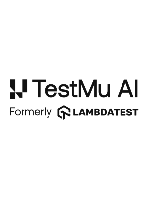

<a>
  <picture>
    <source
      media="(prefers-color-scheme: light)"
      srcset="./docs/images/testmu_black.svg">
    <source
      media="(prefers-color-scheme: dark)"
      srcset="./docs/images/testmu_white.svg">
    
  </picture>
</a>

## Overview

TestMu AI Selenium Automation Grid enables you to perform end-to-end automation tests on a secure, reliable, and scalable Selenium infrastructure. You can perform automated cross browser testing with Selenium scripts on 3000+ browsers and operating systems environments, giving you higher test coverage and at significantly less built times. TestMu AI will help you evaluate how well your web application renders when accessed through a variety of different browsers.


## Features
Features of the TestMu AI Automation Jenkins Plugin:

- Integrate your Jenkins Jobs to run tests on TestMu AI by configuring TestMu AI credentials using the TestMu AI Automation Jenkins Plugin.
- Integrate your freestyle jobs as well as pipeline jobs with TestMu AI using this plugin.
- Set up TestMu AI Tunnel using the TestMu AI Automation Plugin to test your locally hosted web applications or websites.
- View TestMu AI test results on the go after every Jenkins Job run.
- Run natural language browser tests with [Kane CLI](https://www.testmuai.com/kane-cli/), in Chrome on the agent or on the TestMu AI HyperExecute grid, with the **Run Kane CLI tests (TestMu AI)** build step.

## Prerequisites
- Minimum Jenkins version supported is 1.653+.
- A TestMu AI Account, [Sign up now for free](https://accounts.lambdatest.com/register?_gl=1*1okw8h1*_up*MQ..*_gcl_aw*R0NMLjE3MTY4OTE0NTQuRUFJYUlRb2JDaE1JOU9fMWhvLXdoZ01WVjZsbUFoM2x3QU9GRUFBWUFTQUFFZ0pRVVBEX0J3RQ..*_gcl_au*MTkyMjI5MzY5NC4xNzE2ODkxNDU0&gclid=EAIaIQobChMI9O_1ho-whgMVV6lmAh3lwAOFEAAYASAAEgJQUPD_BwE) if you don't have an existing account on TestMu AI.

## Installation and Setup:

- Follow this [TestMu AI Automation Jenkins Plugin Documentation](https://www.testmuai.com/support/docs/jenkins-with-testmu/) to integrate your jenkins freestyle and pipeline job with TestMu AI.

## Run Kane CLI tests

The **Run Kane CLI tests (TestMu AI)** build step (`kaneCli` in pipelines) installs Kane CLI, runs one natural language objective or a suite of committed `_test.md` files, prints a pass/fail verdict with one row per test and the Test Manager link, archives the evidence pack and logs under `kane-out/`, and fails the build when any test fails.

The agent needs Node.js 20 or later with npm. For local runs the step downloads Chrome stable into the workspace's temporary folder (Linux agents need `unzip`); untick **Install Chrome** when Chrome is already installed, or set `KANE_CLI_CHROME_PATH`.

Choose your TestMu AI credentials in the step, or leave them empty to use the `LT_USERNAME` and `LT_ACCESS_KEY` environment variables (for example from the TestMu AI build environment option, `withEnv` or `withCredentials`).

Run one objective:

```groovy
kaneCli credentialsId: 'testmu-ai',
        objective: 'Go to https://staging.example.com/cart, click Checkout and verify the page shows Order Summary'
```

Run every committed test file as one suite with four workers:

```groovy
kaneCli credentialsId: 'testmu-ai', testFiles: 'tests/**/*_test.md', parallel: 4
```

Run the suite on the HyperExecute grid (needs HyperExecute on your plan; the agent needs no Chrome):

```groovy
kaneCli credentialsId: 'testmu-ai', testFiles: 'tests/**/*_test.md', remote: true, parallel: 4
```

| Option | Description | Default |
|---|---|---|
| `credentialsId` | TestMu AI credentials. Empty uses `LT_USERNAME` and `LT_ACCESS_KEY`. | |
| `objective` | Natural language objective, run with `kane-cli run`. Set this or `testFiles`. | |
| `url` | Start URL for an objective. | |
| `testFiles` | Ant-style pattern of `_test.md` files, run as one `kane-cli testrun` suite. | |
| `remote` | Run the `testFiles` suite on the HyperExecute grid. | `false` |
| `timeout` | Max seconds for an objective. | `300` |
| `parallel` | Workers for a suite (grid runners with `remote`). | `1` |
| `failFast` | Stop a suite after the first failure. | `false` |
| `installChrome` | Download Chrome stable for local runs. | `true` |
| `kaneVersion` | Version of `@testmuai/kane-cli` to install. | `latest` |
| `extraArgs` | Extra flags appended to the kane-cli command. | |
| `archiveResults` | Archive `kane-out/` as build artifacts. Open a pack with `kane-cli evidence serve <pack>`. | `true` |

See the Kane CLI guides for [CI/CD](https://github.com/LambdaTest/kane-cli/blob/main/docs/user-guide/cicd.md), [batch runs with testrun](https://github.com/LambdaTest/kane-cli/blob/main/docs/user-guide/testrun.md) and [remote runs on HyperExecute](https://github.com/LambdaTest/kane-cli/blob/main/docs/user-guide/remote-execution.md).
